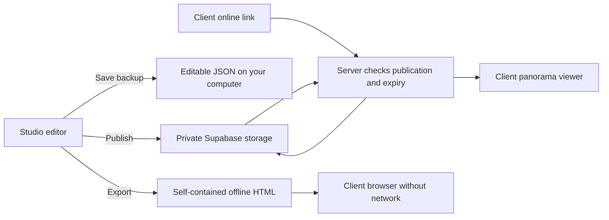

# Rayon Studio: pilot launch and growth roadmap

Updated 16 October 2026. Start with one invited pilot client; the same studio account can manage separate tours for multiple clients. This is a studio-managed delivery service, not yet a client account portal.

## How the site works

1. **Public website — GitHub Pages.** Serves your portfolio, album pages, tour landing page, admin interface and viewer software. Website code changes require a GitHub Pages deployment.
2. **Album administration — GitHub.** Album publishing still uses repository credentials and GitHub commits. It has not been migrated to Supabase.
3. **Tour administration — Supabase Auth.** The confirmed studio email signs in to manage the private tour database and files. Clients do not use this administrator account.
4. **Tour editor — your browser.** Images, rooms, hotspots, alternate styles, plans and branding are edited locally. Unpublished edits are not automatically published. Save a browser draft and download a JSON backup.
5. **Publish — private Supabase Storage and database.** A new immutable JSON file is uploaded, then the database switches to that revision. The previous file is cleaned up afterwards. Each tour has its own ID and link. Tour publication is immediate; it does not wait for GitHub Pages.
6. **Online viewing — public link checked by the server.** The tour-view Edge Function checks publication and expiry, reads the private file and streams it to the viewer. The browser downloads all the tour images together. Foreground tabs recheck availability every 15 seconds. Known expiry still has a local countdown; hidden tabs skip periodic requests and check again on return.
7. **Offline delivery — one HTML file.** Export embeds panoramas, Three.js, controls and required artwork. The client opens the file in a browser without hosting, login or an internet connection. Export creation itself needs the website assets available online. Browser/device support still matters, particularly on mobile.

## Efficiency changes included in this release

| Change | Benefit | What you need to do |
|---|---|---|
| Optimize draft images | Re-encodes panorama and alternate images to WebP when smaller; never upscales | Keep originals, select quality, optimize, inspect, then publish |
| Quality presets | Economy 2048 px / .72 quality; Balanced 3072 px / .82; Detail 4096 px / .90 | These are maximum long-edge dimensions, not promised final sizes |
| Small room thumbnails | Avoids using full panorama images for the optimized tour's room strip | Optimize existing/imported drafts to create thumbnails |
| Size and traffic estimates | Shows JSON size, the 40 MB limit and a conservative traffic planning estimate | Select Check tour size before publishing |
| Search by client/tour title | Keeps multiple client projects easier to locate | Use a consistent title such as Client code — Project — Stage |
| No automatic full-tour gallery downloads | Legacy cloud tours without a cover no longer download every project just to create previews | Opening and republishing creates the normal gallery cover |
| Background efficiency | Skips online status polling and viewer rendering work while hidden | Automatic; visible online tours still check every 15 seconds |
| Self-contained offline export | Removes missing dependency problems when sending HTML alone | Use Download offline viewer; verify with networking disabled |
| Distinct backup/export filenames | Includes the tour title and ID to reduce mix-ups | Keep each client's files in their own folder |

Optimization changes the draft only. Existing published projects and old downloaded files are not rewritten automatically. Logos and floorplans remain unchanged to preserve transparency and fine text. Original images added through the editor already undergo compression (currently up to 2400 px wide); selecting Detail cannot restore discarded detail. Keep original renders outside the app. Tiny tours can grow slightly when thumbnails are added; the size report shows the actual result.

## Online versus offline: what you can promise

| Capability | Online link | Downloaded HTML |
|---|---|---|
| Update content without sending a new file | Yes, publish to the same tour | No, send a new export |
| Disable future access | Take offline/delete; open foreground tabs recheck | No remote revocation |
| Enforce expiry on the server | Yes | No; device-clock expiry is only a convenience |
| Verify a client's identity | Not implemented yet | Not available |
| Prevent forwarding or screenshots | No | No |
| Supabase bandwidth on every opening | Yes | No, once delivered locally |
| Work without internet | No | Yes, in a compatible browser |

Current online links are unlisted bearer links: anyone possessing the link can view it. Private storage does not make recipients individually authenticated. A copied image or downloaded file cannot be recalled. Earlier public Git history can still contain the old sample/Test data. Do not use those historic test projects for confidential client material; create a fresh client tour.

## Capacity, costs and practical limits

- **Current subscription:** Free, verified before this release. No paid upgrade is part of this work.
- **Storage:** 1 GB across the Free organization's storage allowance. Twenty 40 MB tours are roughly 800 MB, but leave room for a new revision during publication and any failed cleanup. File deletion frees stored space when cleanup succeeds; dashboard accounting may lag.
- **Traffic:** 5 GB uncached and a separate 5 GB cached allowance per monthly billing cycle. These are shared allowances, not 5 GB per tour or a daily allowance. The current uncached function response does not automatically gain the cached allowance. Past traffic cannot be undone by deleting files.
- **Planning:** the current Storage → Function → browser route can incur traffic at both stages. Budget about twice the saved JSON size per full opening, plus admin downloads and small API requests, until real dashboard measurements establish actual usage. This is an estimate, not a metered guarantee. Refreshes and repeated openings count again.
- **Example:** a 10 MB tour opened twice by each of two people is about 40 MB delivered, with a conservative 80 MB backend allowance. Twenty tours with two people opening five times each at 20 MB is about 4 GB delivered and potentially 8 GB backend traffic.
- **App limits:** 100 rooms and a 40 MB JSON publish/import limit; panorama inputs up to 20 MB. Base64 encoding adds roughly one-third to the binary image size. Final offline HTML also includes viewer software/artwork, so it is larger than its tour JSON.
- **Free service availability:** excess usage can cause restrictions rather than Free-plan overage charges. Low activity can cause pausing after seven days. Free is appropriate for learning and a carefully monitored pilot, not a promise of uninterrupted client delivery.
- **Paid planning:** Pro currently starts at US$25/month, includes 100 GB storage and 250 GB uncached egress, and may have additional charges for usage/add-ons/compute. Review actual configuration and spend controls before upgrading; the spend cap is not a universal cap on every possible bill item.
- **Identity and devices:** one studio admin email is authorized. No staff roles, per-client logins, verified email invitations, per-client download quotas or automatic usage alerts exist yet. Desktop and mobile browsers differ; phone sensor and headset support must be tested on real hardware.

Sources: [Pricing](https://supabase.com/pricing), [egress accounting and monthly reset](https://supabase.com/docs/guides/platform/manage-your-usage/egress), [cost controls](https://supabase.com/docs/guides/platform/cost-control), [Free project pausing](https://supabase.com/docs/guides/platform/free-project-pausing). Recheck prices before a purchasing decision.

## First-client pilot: suggested operating plan

1. Complete studio signup, email confirmation and a real sign-in. Configure the Auth Site URL to the tour-admin page. Confirm email delivery works; default email delivery is not a production delivery guarantee.
2. Create a **new** client tour with a short client code and clear project/stage title. Start with 3–8 rooms and target under 10 MB after optimization; these are pilot targets, not hard app limits.
3. Agree on one pilot project, two intended viewers, one revision round and a 30-day hosted review period. Explain that the current link can be forwarded; two viewers is an agreement, not a technical restriction. If confidentiality requires verified recipients, complete the access-control phase below before sharing.
4. Keep original panoramas, a dated editable JSON backup and the delivered HTML in a client folder outside the public repository. Save a browser draft during editing. Do not rely on a single browser as your backup.
5. Optimize, inspect each room/alternate, verify hotspots, map and branding. Test the online link on desktop and an actual phone using mobile data. Use Check live link, then verify expiry and taking a disposable test tour offline.
6. Export HTML and open it with networking disabled. Explain that an offline copy remains with the recipient and cannot be remotely withdrawn. Agree whether the client should receive it at all.
7. Record Supabase usage immediately before/after a few controlled openings and again when the dashboard catches up. During the pilot check usage weekly and before presentations. Suggested manual review points: 50%, 75%, 90% of the uncached allowance; these alerts are not automated in the app.
8. Ask the client about loading time, mobile clarity, navigation and usefulness. Record their device and issues without collecting unnecessary personal data. Extend access deliberately or archive after review; keep the agreed retention/backup policy.

Before charging for a dependable hosted service, include hosting/maintenance in your pricing and decide on paid infrastructure. For the first unpaid pilot, stay Free while monitoring usage and keep a tested delivery contingency.

## Roadmap and decision gates

| Stage | Work | Ready when |
|---|---|---|
| Now — one pilot client | Efficiency tools in this release; complete account setup; real-device checks; backup and delivery process | Owner signs in, publishes a disposable tour, confirms expiry/offline behavior and demonstrates online/offline delivery |
| Before confidential client sharing | Verified email invitations per tour; server-side allowed-recipient checks; invite/revoke flows; reliable email provider; session handling and access audit | Forwarded links fail for uninvited users; revoked users cannot fetch new content; failed/expired login tests pass |
| Before several regular clients | Room assets stored separately, small manifest, room-by-room loading, authenticated or short-lived asset delivery, small previews, paginated gallery | Opening room one does not download other panoramas; access controls remain effective; existing links and backups migrate safely |
| Capacity controls | Record loads/bytes per tour; dashboard and usage warnings; abuse rate limits; optional generous session allowances and request-more-access flow | One client cannot silently exhaust the shared allowance; failed requests/retries are handled fairly |
| Paid launch | Suitable hosting plan; database and file restore procedure; monitoring; delivery/retention terms; privacy notice | A restore drill works and service responsibilities are clear |
| Growth | Staff roles, client portal, album/backend consolidation, accessibility review, resumable media uploads, automated deployment and rollback | Multiple projects/operators work without cross-client access or conflicting edits |

Do not equate two email addresses with two human beings or two views. Email verification controls who can establish access; rate limits and per-tour budgets control traffic. Avoid a strict two-opening allowance: refreshes, mobile retries and different devices make it frustrating for legitimate clients. A reasonable future default is two invited emails, a 30-day review period and usage warnings, with an owner-controlled extension. Email delivery may introduce an additional provider cost; review it before enabling a paid service.

Offline files cannot provide equivalent recipient enforcement. Offer them as a separately agreed deliverable rather than claiming the same access controls as an authenticated online service.

## Maintenance and rollback

The published source is in the `.viewer-publish` worktree. Root files and `github-upload` are synchronized release copies; `.publish-repo` is an older worktree and must not be blindly pushed. `backend/pending` is retained as a synchronized compatibility copy for the existing tests. `tools/prepare-tours.cjs` was a one-time migration: do not rerun it to rebuild the current editor.

Run the cloud browser lifecycle test for admin changes, the Edge Function tests for server changes, and the live browser smoke test after Pages deployment. The offline test blocks networking and checks room navigation. Keep changes in Git; revert a website release with a reviewed Git revert. Function deployments are separate from Pages and need their own explicit deployment/verification. Never replace the cloud viewer shells using the old static viewer regeneration script.
